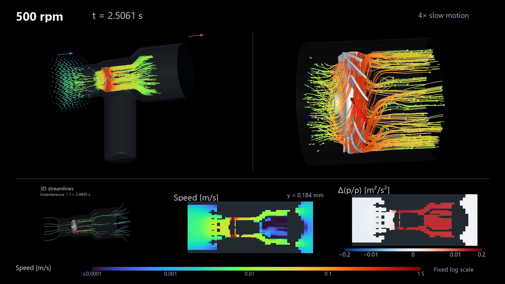

# Hairdryer flow with Cartesian IBM

A completed **500 rpm** incompressible-flow demonstration using LICA's moving immersed boundary method and CPU/OpenMP Fortran solver. This is a compact source-and-setup handoff for people and coding agents.

| Start here | Contents |
|---|---|
| [Case / quick start](IBM_CFD-incomp_CPU-OpenMP_Fortran_Hairdryer-500rpm/README.md) | Build, small IBM tests, private-geometry setup |
| [Agent migration prompt](IBM_CFD-incomp_CPU-OpenMP_Fortran_Hairdryer-500rpm/docs/AGENT_PROMPT_KO.txt) | Copy into another agent |
| [Landscape video](IBM_CFD-incomp_CPU-OpenMP_Fortran_Hairdryer-500rpm/media/hairdryer_500rpm_landscape_red_blade.mp4) | 37 s · 1080p · 60 fps |
| [Portrait video](IBM_CFD-incomp_CPU-OpenMP_Fortran_Hairdryer-500rpm/media/hairdryer_500rpm_portrait_red_blade.mp4) | 37 s · 1080 × 1920 · 60 fps |
| [Results-only summary](IBM_CFD-incomp_CPU-OpenMP_Fortran_Hairdryer-500rpm/media/hairdryer_500rpm_summary.mp4) | About 20.5 s · 720p |
| [Numerics / limits](IBM_CFD-incomp_CPU-OpenMP_Fortran_Hairdryer-500rpm/docs/NUMERICS.md) | Wall/fluid reconstruction, scope and validation |

**Included:** the 15 exact solver build inputs used for the completed case, setup helpers, synthetic IBM checks, native field reader, a small result record, and public videos. **Private CAD/STL, sampled geometry functions, raw fields, checkpoints, executables and internal-report videos are excluded.** Compilation and kernel tests work without those assets. Re-running the actual hairdryer requires authorized `fixed.fn` and `rotor.fn` files supplied separately.

The coarse grid intentionally reduces demonstration time; the approximately 70 µm tip gap is unresolved. The completed physical time is **5.001664 s**. This is not product-performance, tip-leakage or MRV validation. The later high-RPM experimental solver is a different version.

한국어: 500 rpm 완료 사례의 코드·설정·공개 영상·이식 프롬프트 묶음입니다. 형상과 전체 해석 데이터는 제외했습니다. 공개 파일만으로 컴파일/보간 검사가 가능하며, 실제 해석은 별도로 받은 승인된 형상함수를 연결해야 합니다.

Original LICA copyright and noncommercial-use notices are retained. See [NOTICE](NOTICE.md); this archive is not presented as an unrestricted or OSI-licensed solver.
